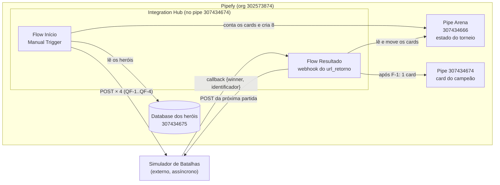
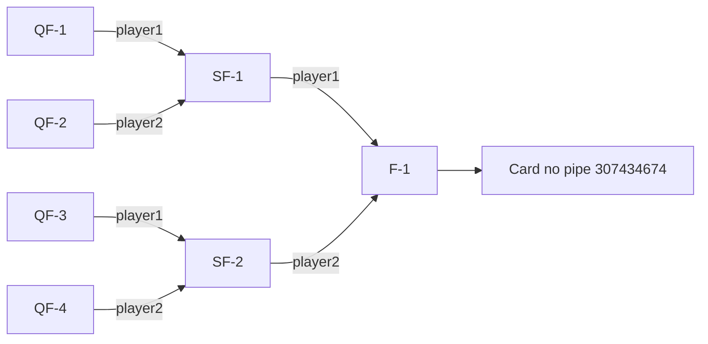
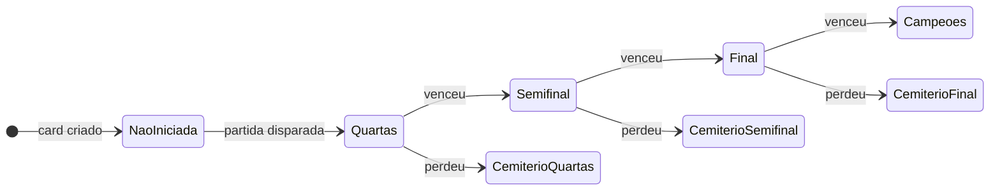

# Arquitetura

Receitas (flows) do Integration Hub da Pipefy que conduzem sozinhas um torneio mata-mata entre 8 heróis, das quartas até o card com o campeão.

As decisões, com alternativas e motivos, estão em [decisoes.md](decisoes.md). O que o Integration Hub oferece está em [pesquisa-integration-hub.md](pesquisa-integration-hub.md), e o contrato do simulador em [simulador.md](simulador.md).

---

## Visão geral

- Os flows ficam na aba Integrations do pipe 307434674 e agem na Arena e no database pela conexão da Service Account (D8).
- Toda leitura é uma consulta GraphQL e toda escrita é uma mutation única, executadas pela Custom API Call do conector. As etapas Code montam as mutations e fazem os POSTs ao simulador (D13). O código e a configuração de cada etapa estão em [flows/](../flows/).
- O pipe 307434674 continua como foi entregue e só recebe o card final de cada torneio (D2).

## Chave do torneio

O identificador de cada partida diz a posição dela na chave. Por isso o callback, que só traz `winner` e `identificador`, basta para saber para onde o vencedor vai.

**Posição fixa (D3).** O sorteio (D6) dá a cada herói uma posição de 1 a 8, que nunca muda. A partida de um card em cada rodada sai da posição:

| Rodada | Partida | Posições | `player1` | `player2` |
| --- | --- | --- | --- | --- |
| Quartas | `QF-⌈p/2⌉` | 1–2, 3–4, 5–6, 7–8 | posição ímpar | posição par |
| Semifinal | `SF-⌈p/4⌉` | 1–4, 5–8 | vem de 1–2 ou 5–6 | vem de 3–4 ou 7–8 |
| Final | `F-1` | 1–8 | vem de 1–4 | vem de 5–8 |

O identificador enviado ao simulador leva o torneio e a partida, como `wakanda-4:SF-1` (D7).

## Estado: a Arena

Cada torneio cria 8 cards na Arena, um por herói. A fase do card é o estado (D1).

**Estado das rodadas.** O enunciado pede rodadas não iniciadas, em andamento e concluídas. Na Arena, esse estado é a ocupação das fases pelos cards do torneio:
- **não iniciada:** a fase da rodada ainda não recebeu cards do torneio;
- **em andamento:** há cards do torneio na fase da rodada;
- **concluída:** todos os cards do torneio já saíram da fase da rodada, para a fase seguinte ou para o cemitério.

**Estado de uma partida.** Uma partida está em andamento quando os dois cards dela estão na fase da rodada. Se só um chegou, ela espera o adversário.

**Campos dos cards (D10):** Título ("Wakanda #4 · Batman", que é o título do card), Herói (texto), Torneio (slug, como `wakanda-4`) e Posição (1 a 8). Os cards de torneios terminados ficam na Arena, com "Campeões" como hall da fama (D11).

**Transições.** Cada fase da Arena só deixa mover o card para as fases do diagrama acima, e as fases finais (cemitérios e Campeões) não deixam mover para lugar nenhum. Os ids das fases e dos campos, e as mutations que montaram a Arena, estão em [setup-arena.md](setup-arena.md).

## Flow Início

Gatilho: **Manual Trigger** (D5).

1. **Ler heróis e Arena:** uma consulta traz os 8 heróis do database 307434675 e o total de cards da Arena.
2. **Sortear chave (Code):** embaralha os heróis, atribui as posições, sorteia o lugar, calcula o número do torneio (D7) e monta a mutation com as 8 criações (D6).
3. **Criar cards na Arena:** executa a mutation. Os cards nascem em "Não iniciada", com Título, Herói, Torneio e Posição.
4. **Preparar quartas (Code):** monta a mutation que move os 8 cards para "Quartas de final".
5. **Mover para as quartas:** executa a mutation.
6. **Disparar quartas (Code):** envia as quatro partidas ao simulador. Os cards são movidos **antes** dos POSTs, para que um callback rápido já encontre a partida em andamento.

## Flow Resultado

Gatilho: **Catch Webhook**, cuja URL é o `url_retorno` enviado ao simulador. O webhook fica sem autenticação, porque o simulador não manda cabeçalho.

1. **Ler partidas em andamento:** uma consulta traz os cards das três fases de rodada da Arena (Quartas, Semifinal e Final), com a hora de entrada na fase.
2. **Validar resultado (Code):** separa o torneio e a partida, acha os dois cards da partida e valida o resultado (veja abaixo). Monta a mutation que move o vencedor para a próxima fase e o perdedor para o cemitério. Na final, a mesma mutation cria o card no pipe 307434674, com "Process Participant Name" = Lucas Alves e "Champion Name" = o campeão.
3. **Router:** resultado inválido termina o flow sem efeito.
4. **Mover cards:** executa a mutation. A resposta já traz os cards da fase de destino, com a hora de entrada de cada um.
5. **Disparar próxima partida (Code):** aplica a regra de disparo (D9) sobre essa resposta. Se este flow for o responsável, envia o POST da próxima partida ao simulador.

**Validação de cada callback.** O callback só é aceito se as três condições valerem. Se alguma falhar, o flow termina sem efeito.
1. O `identificador` corresponde a um torneio com cards na Arena e a uma partida válida da chave.
2. A partida está **em andamento**: os dois cards dela estão na fase da rodada.
3. O `winner` é o herói de um dos dois cards. A comparação ignora maiúsculas e espaços nas pontas.

## Concorrência

- **Callbacks fora de ordem e simultâneos:** as quatro quartas podem voltar no mesmo segundo. Cada callback move só os dois cards da própria partida, então dois callbacks nunca mexem no mesmo card.
- **Disparo da próxima partida (D9):** quando as duas partidas que alimentam uma semifinal terminam juntas, os dois flows podem ver os dois cards na semifinal. Só dispara o flow cujo card entrou na fase por último, pelo `started_current_phase_at`. Esse horário tem precisão de segundo, então o empate acontece: nele, dispara o flow do card de **maior posição**. Como a resposta da mutation é calculada depois do movimento, pelo menos um dos dois flows enxerga o adversário. Nos testes, cada semifinal e cada final foi disparada exatamente uma vez.
- **Callback duplicado ou atrasado:** encontra o vencedor fora da fase da rodada e é descartado pela validação.
- **Sem Storage.** O Integration Hub não documenta operação atômica no Storage, como mostra [pesquisa-integration-hub.md](pesquisa-integration-hub.md#14-storage-o-estado-sem-sair-do-hub). O desenho não usa o Storage: todo o estado está nos cards da Arena.

## Detalhes de implementação

- A URL do webhook do flow Resultado é uma constante no código das etapas de disparo. Ela não é segredo. Se o flow Resultado for recriado, a URL muda e as duas constantes precisam ser atualizadas.
- Os POSTs ao simulador são feitos com `fetch` dentro das etapas Code, com até 3 tentativas em erro de rede ou 5xx. Um reenvio que gere callback duplicado é descartado pela validação.
- A Service Account é membro só da Arena, do pipe 307434674 e do database 307434675 (D8).

## Custo em tarefas

Contagem pelas etapas executadas nas Runs do torneio de teste de 22/11/2026. Gatilho e Router não contam.

| Execução | Etapas que contam | Tarefas |
| --- | --- | --- |
| Início | 1 consulta, 3 Code e 2 mutations | 6 |
| Resultado válido (inclusive a final) | 1 consulta, 2 Code e 1 mutation | 4 |
| Resultado inválido (descartado) | 1 consulta e 1 Code | 2 |

Um torneio completo é 1 execução do Início e 7 do Resultado: **34 tarefas**. As mesmas operações feitas com uma ação do conector por operação custariam cerca de 68 (D13).

**Tempo:** o segundo torneio de teste levou menos de 50 segundos do Run Flow ao card do campeão.

## Limitações conhecidas

- **O callback não tem autenticação.** O simulador não manda cabeçalho, então o webhook de retorno aceita qualquer chamada. A validação por estado impede que um resultado forjado altere uma partida que não está em andamento, mas não impede que alguém que conheça a URL e o estado corrente envie um vencedor válido antes do simulador.
- **O simulador não garante prazo nem entrega.** Se um callback nunca chegar, os dois cards da partida ficam parados na fase da rodada. Não há reenvio automático (veja [simulador.md](simulador.md#pontos-ainda-não-verificados)).
- **Partida parada não se recupera sozinha.** Se uma execução do flow Resultado falhar depois de mover os cards, a próxima partida não é disparada. O "Retry" do Hub não resolve: repetir a partir do passo que falhou usa a versão antiga do flow, e repetir do começo reprocessa um callback que já não é válido. A recuperação é reenviar a partida ao simulador à mão, com o mesmo `identificador_da_rodada` (veja [testes.md](testes.md)).
- **A validade do token da Service Account é fixa,** escolhida na criação (até 30 dias). Quando vencer, é preciso criar outra conta e atualizar a conexão.
