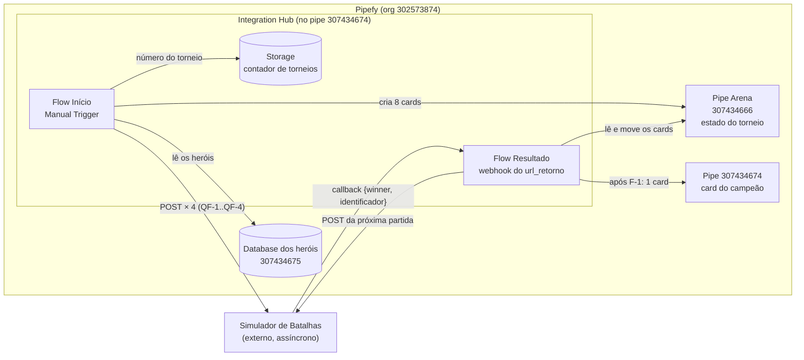
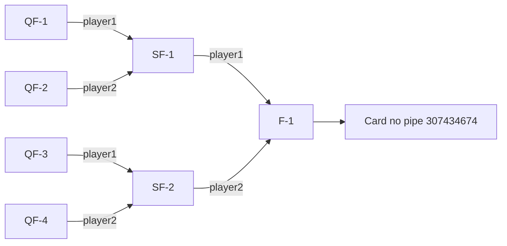
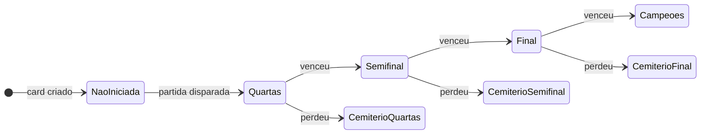

# Arquitetura

Receitas (flows) do Integration Hub da Pipefy que conduzem sozinhas um torneio mata-mata entre 8 heróis, das quartas até o card com o campeão.

As decisões, com alternativas e motivos, estão em [decisoes.md](decisoes.md). O que o Integration Hub oferece está em [pesquisa-integration-hub.md](pesquisa-integration-hub.md), e o contrato do simulador em [simulador.md](simulador.md).

---

## Visão geral

- Os flows ficam na aba Integrations do pipe 307434674 e agem na Arena e no database pela conexão da Service Account (D8).
- O pipe 307434674 continua como foi entregue e só recebe o card final de cada torneio (D2).

## Chave do torneio

O identificador de cada partida diz a posição dela na chave. Por isso o callback, que só traz `winner` e `identificador`, basta para saber para onde o vencedor vai.

**Posição fixa (D3).** O sorteio (D6) dá a cada herói uma posição de 1 a 8, que nunca muda. A partida de um card em cada rodada sai da posição:

| Rodada | Partida | Posições | `player1` | `player2` |
| --- | --- | --- | --- | --- |
| Quartas | `QF-⌈p/2⌉` | 1–2, 3–4, 5–6, 7–8 | posição ímpar | posição par |
| Semifinal | `SF-⌈p/4⌉` | 1–4, 5–8 | vem de 1–2 ou 5–6 | vem de 3–4 ou 7–8 |
| Final | `F-1` | 1–8 | vem de 1–4 | vem de 5–8 |

O identificador enviado ao simulador leva o torneio e a partida, como `wakanda-4:SF-1` (D7).

## Estado: a Arena

Cada torneio cria 8 cards na Arena, um por herói. A fase do card é o estado (D1).

**Estado das rodadas.** O enunciado pede rodadas não iniciadas, em andamento e concluídas. Na Arena, esse estado é a ocupação das fases pelos cards do torneio:
- **não iniciada:** a fase da rodada ainda não recebeu cards do torneio;
- **em andamento:** há cards do torneio na fase da rodada;
- **concluída:** todos os cards do torneio já saíram da fase da rodada, para a fase seguinte ou para o cemitério.

**Estado de uma partida.** Uma partida está em andamento quando os dois cards dela estão na fase da rodada. Se só um chegou, ela espera o adversário.

**Campos dos cards (D10):** Herói (texto), Torneio (slug, como `wakanda-4`) e Posição (1 a 8). O título é "Wakanda #4 · Batman". Os cards de torneios terminados ficam na Arena, com "Campeões" como hall da fama (D11).

## Flow Início

Gatilho: **Manual Trigger** (D5).

1. Lê os 8 heróis do database 307434675.
2. Lê o contador de torneios no Storage.
3. **Code:** embaralha os heróis, atribui as posições, sorteia o lugar e monta o nome, o slug e as quatro partidas (D6, D7).
4. Grava o contador incrementado no Storage.
5. Cria os 8 cards na Arena, em "Não iniciada".
6. Para cada partida das quartas: move os dois cards para "Quartas de final" **e depois** envia o POST ao simulador. Os cards são movidos antes do POST para que um callback rápido já encontre a partida em andamento.

## Flow Resultado

Gatilho: **Catch Webhook**, cuja URL é o `url_retorno` enviado ao simulador. O webhook fica sem autenticação, porque o simulador não manda cabeçalho.

1. Lê os cards do torneio indicado no `identificador`, com o `phases_history`.
2. **Code:** separa o torneio e a partida, acha os dois cards da partida e valida o resultado (veja abaixo). Define o vencedor, o perdedor e as fases de destino.
3. **Router:** resultado inválido termina o flow sem efeito.
4. Move o vencedor para a fase da próxima rodada e o perdedor para o cemitério da rodada.
5. **Se a partida era a final:** cria o card no pipe 307434674, com "Process Participant Name" = Lucas Alves e "Champion Name" = o campeão, e termina.
6. Senão, lê de novo os cards do torneio e, numa etapa **Code**, aplica a regra de disparo (D9). Se este flow for o responsável, envia o POST da próxima partida ao simulador.

**Validação de cada callback.** O callback só é aceito se as três condições valerem. Se alguma falhar, o flow termina sem efeito.
1. O `identificador` corresponde a um torneio com cards na Arena e a uma partida válida da chave.
2. A partida está **em andamento**: os dois cards dela estão na fase da rodada.
3. O `winner` é o herói de um dos dois cards. A comparação ignora maiúsculas e espaços nas pontas.

## Concorrência

- **Callbacks fora de ordem e simultâneos:** as quatro quartas podem voltar no mesmo segundo. Cada callback move só os dois cards da própria partida, então dois callbacks nunca mexem no mesmo card.
- **Disparo da próxima partida (D9):** quando as duas partidas que alimentam uma semifinal terminam juntas, os dois flows podem ver os dois cards na semifinal. Só dispara o flow cujo card entrou na fase por último, pelo `lastTimeIn`. No empate, dispara o flow do card de posição par. Como cada flow move antes de ler, pelo menos um deles enxerga o adversário, desde que a leitura reflita o movimento do outro na hora.
- **Callback duplicado ou atrasado:** encontra o vencedor fora da fase da rodada e é descartado pela validação.
- O Integration Hub não documenta operação atômica no Storage, como mostra [pesquisa-integration-hub.md](pesquisa-integration-hub.md#14-storage-o-estado-sem-sair-do-hub). O único valor no Storage é o contador de torneios, escrito só pelo flow de início, que é manual.

## Detalhes de implementação

- A URL do webhook do flow Resultado fica numa **Variable** do Hub, que o flow Início usa para montar o `url_retorno`. Ela não é segredo.
- O POST ao simulador usa a política de retry da peça HTTP para erros 5xx. Um reenvio que gere callback duplicado é descartado pela validação.
- A Service Account é membro só da Arena, do pipe 307434674 e do database 307434675 (D8).

## Custo estimado em tarefas

Estimativa por torneio, a confirmar na aba Runs depois do primeiro torneio completo. Gatilho e Router não contam.

| Flow | Etapas que contam | Tarefas |
| --- | --- | --- |
| Início | leitura dos heróis, Get e Put do contador, Code, 8 criações, 8 movimentações e 4 POSTs | ~24 |
| Resultado, partida que dispara a seguinte | 2 leituras, 2 Code, 2 movimentações e 1 POST | 7 |
| Resultado, partida que não dispara | 2 leituras, 2 Code e 2 movimentações | 6 |
| Resultado, final | 1 leitura, 1 Code, 2 movimentações e 1 criação de card | 5 |

Com 3 callbacks que disparam, 3 que não disparam e a final, o torneio custa cerca de **68 tarefas**.

## Limitações conhecidas

- **O callback não tem autenticação.** O simulador não manda cabeçalho, então o webhook de retorno aceita qualquer chamada. A validação por estado impede que um resultado forjado altere uma partida que não está em andamento, mas não impede que alguém que conheça a URL e o estado corrente envie um vencedor válido antes do simulador.
- **O simulador não garante prazo nem entrega.** Se um callback nunca chegar, os dois cards da partida ficam parados na fase da rodada. Não há reenvio automático (veja [simulador.md](simulador.md#pontos-ainda-não-verificados)).
- **A regra de disparo depende de a leitura refletir o movimento na hora.** Se a busca de cards tiver atraso, os dois flows de uma semifinal podem não enxergar o adversário, e a partida não é disparada. Isso é verificado no primeiro teste.
- **A validade do token da Service Account é fixa,** escolhida na criação (até 30 dias). Quando vencer, é preciso criar outra conta e atualizar a conexão.
