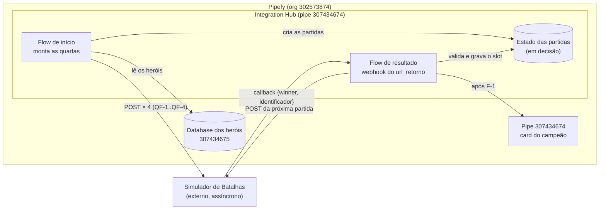
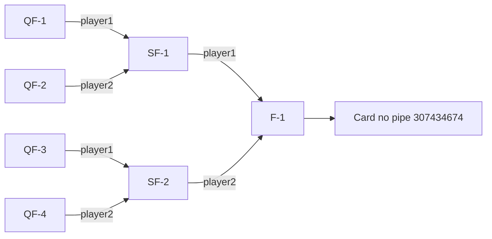
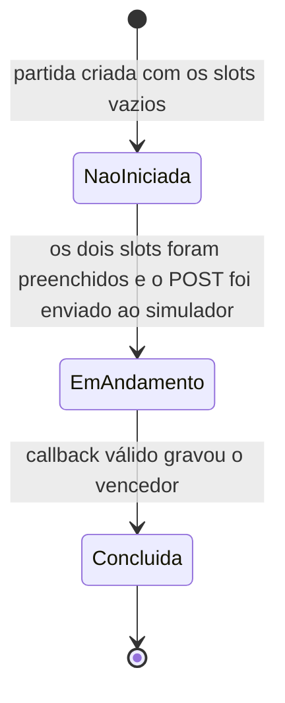

# Arquitetura

Receitas (flows) do Integration Hub da Pipefy que conduzem sozinhas um torneio mata-mata entre 8 heróis, das quartas até o card com o campeão.

As decisões, com alternativas e motivos, estão em [decisoes.md](decisoes.md). O que o Integration Hub oferece está em [pesquisa-integration-hub.md](pesquisa-integration-hub.md), e o contrato do simulador em [simulador.md](simulador.md).

> **Em construção.** Este documento cobre o que não depende das decisões em aberto. A forma de guardar o estado e a divisão em flows entram aqui quando forem decididas.

---

## Visão geral

## Chave do torneio

O identificador de cada partida diz a posição dela na chave. Por isso o callback, que só traz `winner` e `identificador`, basta para saber para onde o vencedor vai.

**Regra:** o vencedor de `<rodada>-n` vai para a partida `⌈n/2⌉` da rodada seguinte. Se n for ímpar, ele entra como `player1`; se for par, como `player2`.

## Ciclo de vida de uma partida

Esses três estados são os que o enunciado pede: rodada não iniciada, em andamento e concluída. A rodada está concluída quando todas as partidas dela estão concluídas.

**Validação de cada callback.** O callback só é aceito se as três condições valerem. Se alguma falhar, o flow termina sem efeito.
1. O `identificador` corresponde a uma partida existente do torneio ativo.
2. A partida está **em andamento**.
3. O `winner` é um dos dois jogadores dela.

## Concorrência

- **Callbacks fora de ordem e simultâneos:** as quatro quartas podem voltar no mesmo segundo. Cada callback grava **só o slot dele** na partida seguinte. Assim, dois callbacks nunca sobrescrevem o mesmo dado.
- **Disparo duplicado:** os dois callbacks de uma semifinal podem ver os slots cheios ao mesmo tempo e disparar a final duas vezes. O primeiro resultado que encontrar a final em andamento conclui a partida, e o segundo é rejeitado pela validação de estado.
- O Integration Hub não documenta operação atômica no Storage, como mostra [pesquisa-integration-hub.md](pesquisa-integration-hub.md#14-storage-o-estado-sem-sair-do-hub). Por isso, o desenho evita ler, alterar e gravar um valor compartilhado.

## Limitações conhecidas

- **O callback não tem autenticação.** O simulador não manda cabeçalho, então o webhook de retorno aceita qualquer chamada. A validação por estado impede que um resultado forjado altere uma partida que não está em andamento, mas não impede que alguém que conheça a URL e o estado corrente envie um vencedor válido antes do simulador.
- **O simulador não garante prazo nem entrega.** Se um callback nunca chegar, a partida fica em andamento. Não há reenvio automático (veja [simulador.md](simulador.md#pontos-ainda-não-verificados)).
